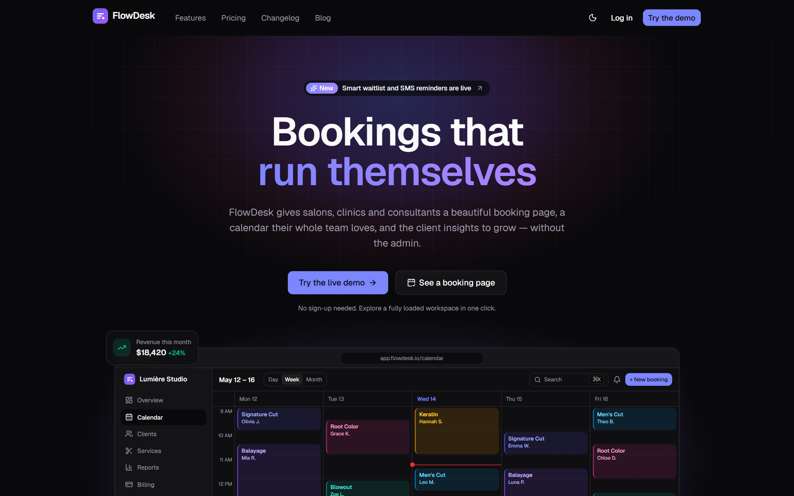
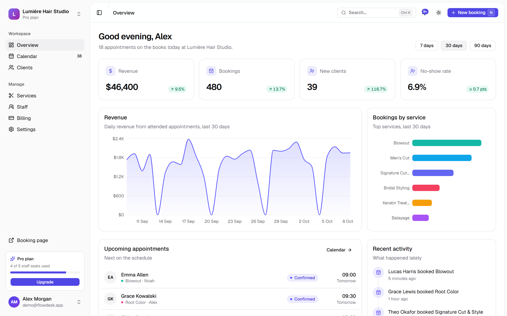
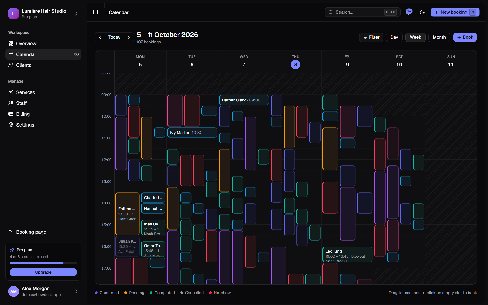

# FlowDesk

Appointment booking and client management for small businesses. Salons, clinics and consultants get a polished public booking page, a team calendar with drag-and-drop rescheduling, a client CRM and subscription billing in one calm workspace.

**Repo:** [github.com/saadxhammad/Github-CRM](https://github.com/saadxhammad/Github-CRM). Click "Try the live demo" after deploy to explore a fully loaded workspace, no sign-up needed.

Personalized demo by Saad Abdullah — [github.com/saadxhammad](https://github.com/saadxhammad)



## Highlights

- **Public booking flow:** clients pick a service, a team member and a real open slot, then get an instant confirmation and a calendar file. Slots respect working hours, lead time and existing bookings.
- **Team calendar:** day, week and month views, colour-coded by status, with drag-to-reschedule, conflict checks and quick create from any empty slot.
- **Client CRM:** a sortable, filterable table with bulk actions and CSV export, plus client profiles with visit history, lifetime value and notes.
- **Insights dashboard:** revenue, bookings, new clients and no-show rate with trends, charts, upcoming appointments and a live activity feed.
- **Billing:** Free, Pro and Business plans with monthly or yearly pricing, Stripe Checkout and the customer portal, webhook-driven plan changes and invoices.
- **Teams and settings:** staff roles and permissions, per-day working hours, service catalogue, business branding and a custom booking link.
- **Works instantly:** a one-click demo workspace with realistic data that persists in the browser, with optimistic updates throughout.
- **Built to feel fast:** a command palette (Ctrl/⌘ K), keyboard shortcuts, light and dark themes, skeleton loading states and an accessible, responsive UI.
- **Secure by design:** Postgres row-level security isolates every workspace, and all writes are scoped by role.
- **SEO-ready:** metadata, dynamic Open Graph images, sitemap, robots and JSON-LD structured data.





## Tech stack

- [Next.js](https://nextjs.org) (App Router, React Server Components) and TypeScript
- [Tailwind CSS v4](https://tailwindcss.com), [shadcn/ui](https://ui.shadcn.com) and Framer Motion
- [Supabase](https://supabase.com) (Postgres, Auth, row-level security) with [Drizzle ORM](https://orm.drizzle.team)
- [Stripe](https://stripe.com) Checkout, Billing Portal and webhooks
- TanStack Table, Recharts, react-hook-form and zod
- MDX blog, Geist typeface, deployed on [Vercel](https://vercel.com)

## Run locally

```bash
npm install
npm run dev
```

Open [http://localhost:3000](http://localhost:3000) and click "Try the live demo". The app runs fully in demo mode out of the box.
